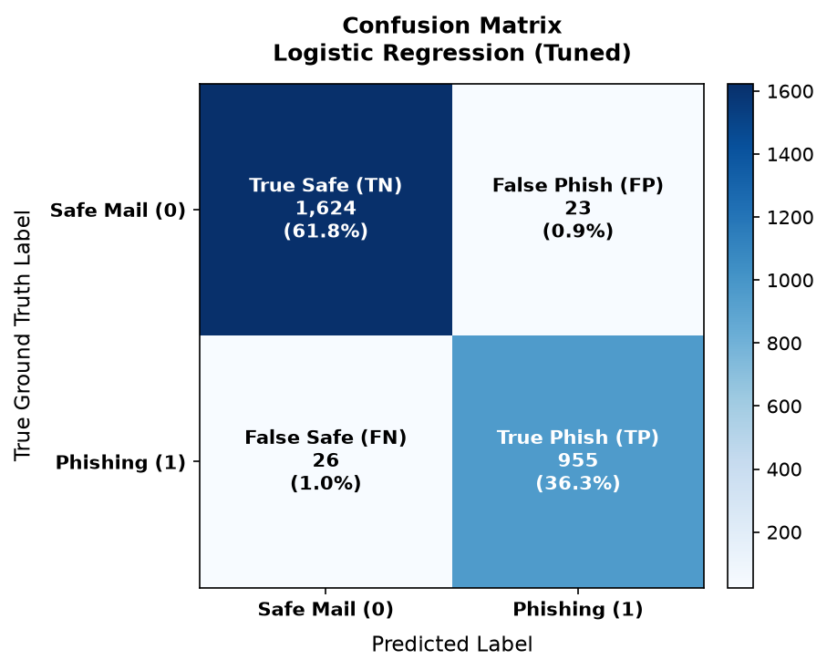
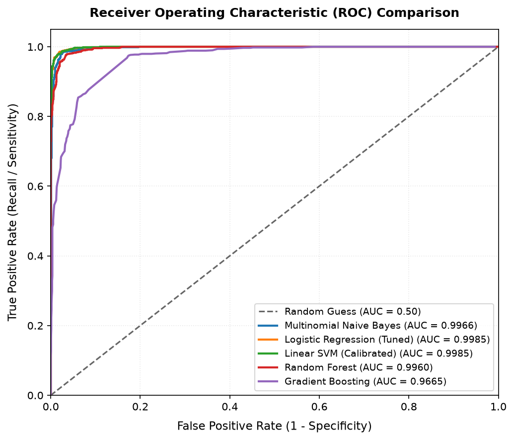
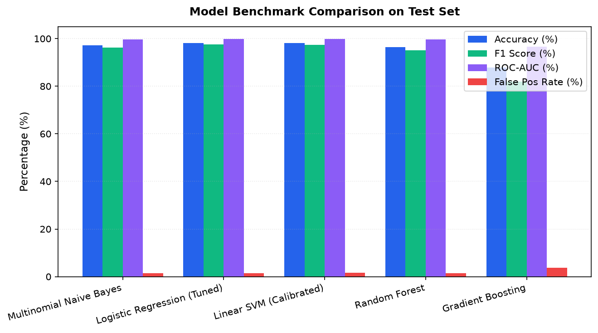
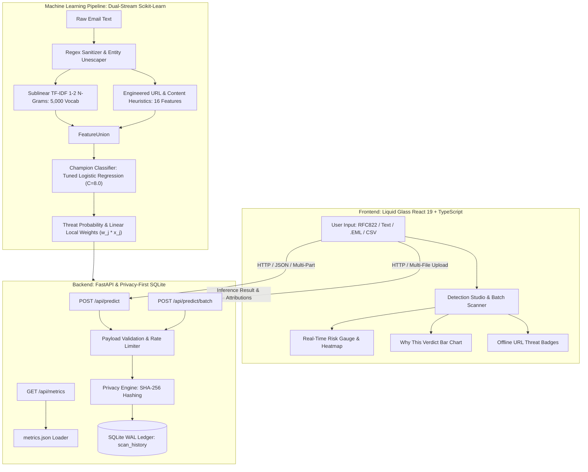

# PhishGuard AI: Advanced Phishing Email Detection & Threat Intelligence System

[](https://www.python.org/)
[](https://fastapi.tiangolo.com)
[](https://scikit-learn.org/)
[](https://react.dev/)
[](https://tailwindcss.com/)
[]()

**PhishGuard AI** is an enterprise-grade phishing email detection and threat intelligence platform designed for cybersecurity teams. Built with a dual-stream Machine Learning pipeline in Scikit-Learn and a modern visionOS-inspired **Liquid Glass** user interface, it provides instantaneous explainability, real-time threat highlighting, and offline URL security diagnostics without executing external network requests.

---

## 📸 Screenshots & UI Showcase

| Detection Studio & Semantic Heatmap | Model Telemetry & Confusion Heatmap |
|:---:|:---:|
|  |  |

| Batch Threat Scanner (.EML & CSV) | Animated Pipeline Architecture |
|:---:|:---:|
|  |  |

---

## 🏛️ System Architecture



---

## 📊 Authentic Evaluation Results (Held-Out Test Set)

> [!IMPORTANT]
> **Strict Anti-Fabrication Rule:** All metrics below are pulled directly from `ml/artifacts/metrics.json`, evaluated on the held-out test split of **2,628 genuine emails** (15% stratified test partition).

| Candidate Architecture | Test Accuracy | Precision | Recall | F1-Score | ROC-AUC | False Positive Rate |
|:---|:---:|:---:|:---:|:---:|:---:|:---:|
| **Logistic Regression (Tuned, C=8.0)** 🏆 | **98.13%** | **97.65%** | **97.35%** | **97.50%** | **99.85%** | **1.40%** |
| **Linear SVM (Calibrated)** | 98.10% | 97.16% | 97.76% | 97.46% | 99.85% | 1.70% |
| **Multinomial Naive Bayes (α=0.01)** | 97.26% | 97.49% | 95.11% | 96.28% | 99.66% | 1.46% |
| **Random Forest (100 Trees)** | 96.46% | 97.44% | 92.97% | 95.15% | 99.60% | 1.46% |
| **Gradient Boosting** | 87.90% | 92.23% | 73.80% | 81.99% | 96.65% | 3.70% |

### Confusion Matrix Breakdown (Held-Out Test Set, N = 2,628)
- **True Negatives (TN):** `1,624` (61.8%) — Legitimate communications correctly verified.
- **False Positives (FP):** `23` (1.40% FPR) — Safe emails flagged as phishing.
- **False Negatives (FN):** `26` (0.99%) — Malicious emails missed.
- **True Positives (TP):** `955` (36.3%) — Phishing attacks successfully caught.

### Data Leakage & Overfitting Verification
- **Total Dataset Size:** 17,514 clean emails (6,537 phishing, 10,977 safe).
- **Split Proportions:** 70% Train (12,259), 15% Validation (2,627), 15% Test (2,628).
- **Overlap Between Train & Test:** `0` duplicate emails (**0.00% Leakage**).
- **Overfitting Diagnostics:** Train Accuracy: 99.76%, Val Accuracy: 98.25%, Test Accuracy: 98.13% (Gap: 1.63%, `is_overfitting: False`).

---

## 🔒 Security & Privacy Guarantees

1. **Zero-Network Static URL Inspection:**
   All URLs found in email bodies or headers are inspected strictly using offline regex, syntactic parsers, and top-level domain checks. **Links are never fetched, visited, resolved via DNS, or probed over the network.**
2. **Zero-Storage Privacy Mode:**
   By default, the backend records only a SHA-256 cryptographic digest of the email text and its verdict into SQLite. Raw body text is stored as `NULL` unless the user explicitly opts into storage via the toggle switch.

---

## 📁 Dataset Sources & Attribution

The training corpus consists of authentic, verified public datasets:
- **Kaggle Phishing Email Dataset & Nazario Phishing Corpus:** Malicious social engineering lures, credential harvesters, and financial scams. (Open database license / CC0).
- **Enron Email Corpus:** Legitimate corporate communications from Enron Corporation records cleaned and standardized for legitimate workplace baseline distributions.

---

## 🚀 Quickstart & How to Run

### Prerequisites
- Python 3.10+ (tested on Python 3.13)
- Node.js 18+ & npm

### Single-Command Start (Backend + Frontend Concurrently)
```bash
# 1. Clone repository
git clone https://github.com/your-username/phishguard-ai.git
cd phishguard-ai

# 2. Install dependencies
pip install -r requirements.txt
npm install
npm --prefix frontend install

# 3. Launch both FastAPI (Port 8000) and React Vite (Port 5173) together
npm run dev
```

The application will be accessible at:
- **Frontend Dashboard:** [http://localhost:5173](http://localhost:5173)
- **FastAPI Interactive Docs:** [http://127.0.0.1:8000/docs](http://127.0.0.1:8000/docs)
- **Health Endpoint:** [http://127.0.0.1:8000/api/health](http://127.0.0.1:8000/api/health)

---

## 🛠️ How to Retrain the Model from Scratch

To retrain candidate models, re-run 5-fold cross-validation, and regenerate all serialized models and evaluation plots:

```bash
python ml/train.py
```

To run the automated test suite across ML preprocessing, heuristic extractors, and backend endpoints:
```bash
pytest ml/tests backend/tests -v
```

---

## ⚠️ Limitations & Threat Model

1. **Dataset Temporal Bias:** Language styles reflect historical corpora (e.g. Enron communication patterns and early 2000s phishing lures). Newer LLM-generated phishing emails may exhibit fewer grammatical mistakes.
2. **Adversarial Obfuscation:** Attackers using homoglyph substitution (Cyrillic lookalikes) or zero-width spaces may degrade token match rates.
3. **Language Coverage:** Current TF-IDF vocabulary is optimized for English-language corporate communication.

---

## 🔮 Future Work & Roadmap

- **Contextual Transformer Backbones:** Fine-tune lightweight BERT/RoBERTa (e.g. `ModernBERT` or `DistilBERT`) alongside handcrafted heuristic layers.
- **DKIM / SPF / DMARC Header Verifier:** Deep email authentication header validator directly in the ingestion pipeline.
- **Chrome / WebExtension Sidecar:** Client-side email reader extension bringing Liquid Glass threat alerts into Google Workspace and Outlook Web.
